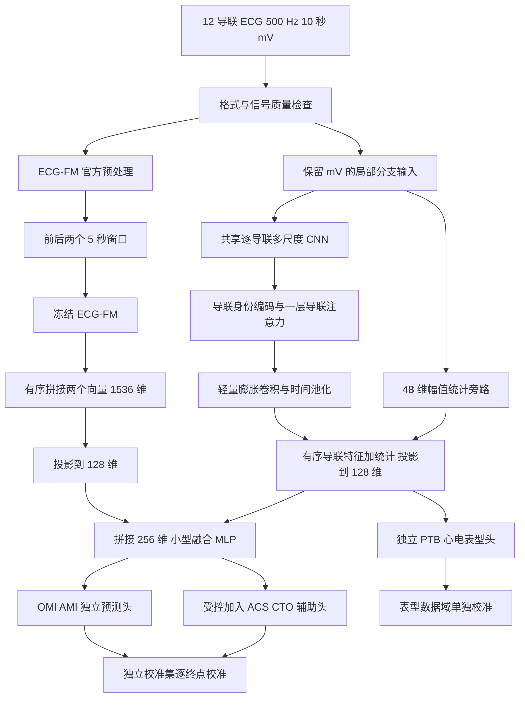

# ECG 冠脉相关风险模型调研与架构方案

版本 1.0　检索与设计日期 2026 年 10 月 9 日

**推荐主架构：冻结 ECG-FM 的预训练表征分支，加一个保留 mV 单位的轻量多尺度导联分支，使用小型融合网络和独立多任务头，最后逐任务校准。** ECG-CPC/S4 作为必须比较的轻量替代骨干；ST-MEM 与 ECG-FM 的双基础模型融合作为有文献依据的对照。先通过消融证明每个组件有用，再考虑更复杂的门控、微调或超声融合。

这是针对本项目提出的组合设计，尚未实现或训练，不能把各篇论文的性能当成组合后的性能。已运行的 NumPy 基线仍然是旧基线。本文件细化并更新《项目规划》的模型部分，临床终点、数据来源和 CAD 标签限制继续沿用。

## 1 选择依据

本地核心监督数据只有 17,960 条带标签 ECG，其中 OMI 阳性 1,151 条、1,139 位患者；另有 PTB-XL 和 MIMIC。当前设备已核实为 RTX 5060、8,151 MiB 显存，物理内存约 31.8 GiB。这个条件适合冻结基础模型提取特征，以及训练小型局部分支和预测头；不宜把从零训练多个大型基础模型作为首轮任务。

优先考虑四点：对冠脉终点的证据是否直接；代码、权重和预处理能否实际获得；能否保留细微 ST/T 形态和真实电压；能否在本地显存和阳性事件数下可靠训练。模型在心律失常或报告关键词任务上得分高，并不等于在造影证实的 OMI 上最好。

本次研究覆盖已能核验的 2024–2026 年主要 ECG 模型及相关模块，并保留较早但必要的对照；不是对所有论文的系统综述。论文、预印本、仓库说明和本项目设计假设分别标注。

## 2 最新证据对选型的影响

### 2.1 OMI 直接证据仍支持保留强 CNN 对照

2026 年 Nature Communications 的 *A deep learning ECG model for identification and localization of occlusion myocardial infarction* 使用 540,372 条急诊 ECG 和导管检查结果，核心是 **一维 ResNet、年龄/性别及 5 个模型的集成**。摘要报告 OMI C-statistic 约 0.95，而 InCor 外部 OMI 对照约 0.83，说明队列差异会显著影响性能。模型还研究了罪犯血管定位。[1]

这项研究比普通心律分类更贴近本项目，但其样本规模、参考标准与患者构成不同。代码可访问，参数/权重按论文需申请；不能声称下载即可获得同等性能，也不能直接将其 PTB-XL/STEMI 评估等同 OMI 外部验证。

### 2.2 基础模型的优势取决于任务和读出方式

ICLR 2026 *Benchmarking ECG Foundational Models* 比较 12 个数据集、26 项任务和 1,650 个目标。ECG-CPC/S4 在多类任务较强；ECG-FM 在部分急性照护任务较强；没有一个模型处处领先。这里的“急性照护”包括恶化、死亡及 ICU 入院，并非专门的 OMI 试验。[2]

该研究特别区分线性探测、冻结骨干加 query-attention pooling、全量微调。用不合适的简单平均读出可能低估某些冻结编码器，因此比较不能只换一个模型名称，必须同时保留其合理的预处理及读出方案。

### 2.3 与本项目最直接相关的融合先导研究

2025 年 *Fusion of ECG Foundation Model Embeddings to Improve Early Detection of ACS* 将 ECG-FM 与 ST-MEM 的 768 维向量分别归一化、拼接，再用 XGBoost 分类。5,813 条院前 ECG 中有 1,207 条 ACS，10 次随机 80/20 划分的平均 AUROC 为：ECG-FM 0.835，融合 0.843。[3]

这个约 0.008 的差值是“互补表征值得研究”的证据，不是复杂融合必然提升的证明。论文没有提供本项目需要的造影 OMI 外部验证，且随机重复划分与患者独立性需要核查；文中 ResNet 标准差还有异常排版，不能用其表格直接构造跨论文排行榜。本项目称之为“方法适配对照”，不冒称在不同数据上严格复现了该研究。

## 3 模型候选比较

参数数目采用论文或基准口径，可能因输出头、封装不同而变化。权重“公开”仅表示找到作者发布入口，本次没有下载或运行这些 checkpoint。

| 候选 | 时间及依据 | 核心机制 | 获取和适配情况 | 本项目决定 |
|---|---|---|---|---|
| ECG-FM | JAMIA Open 2025 [4] | CNN 下采样加 12 层 Transformer；WCR 混合自监督 | 作者约 90.9M 参数；公开代码/权重；500 Hz，5 秒片段，z-score | **主方案冻结全局分支** |
| ECG-CPC/S4 | ICLR 2026 [2] | 卷积编码加 4 层 S4，CPC 预训练 | 约 3.8M；公开 checkpoint；原生 240 Hz；需合理 token 读出 | **必做的低成本替代骨干** |
| ECGFounder | NEJM AI 2025 [5] | Net1D/RegNet 风格 CNN、分组卷积和通道注意力 | 约 33.8M；千万级 ECG 监督预训练；公开权重 | 强 CNN 迁移对照，第二批 |
| ST-MEM | ICLR 2024 [6] | 导联/时间 patch、MAE、导联标识与解码设计 | 约 90M；250 Hz；官方 0.67–40 Hz、z-normalization；许可有额外限制 | 与 ECG-FM 冻结融合对照；不作为唯一缺血分支 |
| ECG-JEPA | 2024 预印本，2026-07 在线发表 [7] | 潜空间掩码预测、跨模式注意力、teacher/student | 约 87.2M；公开代码/权重；期刊卷期为 2027-01，已提前在线发表 | 低标签对照，暂不自行复现大规模预训练 |
| HuBERT-ECG | 2024 起预印本及公开实现 [8] | 离散表征目标与掩码自监督 | 大模型；公开入口；非商业许可条件需核对具体权重 | 扩展基准，非首批 |
| CSFM | Nature Machine Intelligence 2026 [9] | 多模态掩码学习，ECG/PPG/文本，Tiny/Base/Large | 当前仓库要求签署 Academic Access Agreement 后申请权重；不是直接下载即用 | 方法参考，待获得权重再评估 |
| ECG-CLIP，Scripps | Lancet Digital Health 2026-09 [10] | 先 MAE 后 ECG–文本对比；8 个独立导联、Transformer | 已找到代码，但未找到官方 checkpoint；数据读取有占位实现 | 文本对齐研究候选，首版不依赖 |
| D-BETA/MERL/KED | 2024–2025 原始方法及基准 [2,11] | ECG 与报告的对比/重建表征 | 部分有代码/权重；监督来源主要是报告语义 | 以后有可靠文本配对时再纳入 |
| ECG-Mamba | IEEE JTEHM 2025 [12] | 双向状态空间模型与特定增强 | 主要是 CinC 多标签异常研究，不是造影 OMI 证据 | 作为局部时序模块的替换实验 |
| Mamba-3 | 2026 原文与官方仓库 [13] | 状态递推、复值状态、MIMO 等改进 | 主要证明语言/状态跟踪性能；官方核心环境 Linux | 不因最新而纳入主线 |
| 一维 ResNet | 2026 OMI 直接研究 [1] | 局部形态残差卷积 | 自定义小模型易做公平基线；原研究权重需申请 | **必须保留的端到端对照** |
| PatchTST 思路 | ICLR 2023 [14] | patch、通道独立编码 | 原任务主要是通用时序预测；无本项目 OMI 直接证据 | 借鉴压缩与共享编码，不照搬全部结构 |

两个名称细节必须记录：ECGFounder 是卷积骨干，不是 Transformer；ECG-CPC 是 S4 路线，不等于 Mamba。2026 Scripps 的 ECG-CLIP 与 2025 年另一同名模型也不是同一模型。

ECG-CLIP 的官方下游构建脚本以 ECG 报告关键词定义 AMI，不能把其少样本 AMI AUC 当作肌钙蛋白/造影参考标准的结果。这是标签层面的适用限制，不是对其表示学习方法的否定。

## 4 拟定主架构

### 4.1 总体组合

设计代号为 `ecg_coronary_fusion_v1`。主线固定一个大型预训练骨干，新增模块保持小型化。

**组合逻辑**：ECG-FM 提供从大规模 ECG 学到的表征；局部分支保留预训练 z-score 可能弱化的物理电压和导联细节；小型融合头学习两类信息对本项目终点的增益。两个分支各自处理同一条 ECG，不能把基础模型归一化后的信号再当作 mV 输入。

### 4.2 A 分支 冻结 ECG-FM

输入原始记录经匹配 checkpoint 的官方处理流程，得到前 5 秒和后 5 秒两个窗口。冻结包括所有参数、dropout 的评估状态及任何运行统计。每个窗口按官方下游读出得到 768 维向量，固定前后顺序拼为 1,536 维，再用 `Linear(1536,128) → GELU → Dropout(0.2)`。

原生标准化顺序、导联顺序、处理窗口必须从所选 checkpoint 配套代码锁定；论文只有 z-score 描述的部分不能自行猜测。记录 repo commit、checkpoint SHA256、处理配置和读出层。优先取最终版公开基础权重，不误用已在 MIMIC 标签上微调的分类权重。

两个窗口是分别编码再融合，**这不是完整 10 秒内逐 token 的长程交互**。它能保留两段表征，跨边界心搏关系主要由局部分支连续处理补充。固定顺序拼接与窗口平均作为一次消融，不同时引入第三个大型时序模型。

首轮缓存最终向量。17,960 条记录的两个 768 维 float16 向量约 55 MB；全量约 80 万条则约 2.46 GB，均不含索引开销。缓存只加速冻结版本，解冻骨干后必须重新前向。若以后采用可训练 query-attention，需要保存 token 或实时计算，不能从已经池化的向量重建 token。

### 4.3 B 分支 保幅的轻量导联编码器

这是本项目新设计，不是从上述论文复制得到的已验证架构。所有以下超参数是起始配置。

| 层级 | 起始结构 | 输出形状 |
|---|---|---|
| 输入 | 12 导联、500 Hz、10 秒；校准电压 mV | `[B,12,5000]` |
| 逐导联共享 stem | 三路 Conv1d，kernel 15/31/63，stride 2，每路 16 通道；GELU，拼接 | `[B,12,48,2500]` |
| 下采样残差层 | 3 级 kernel 7、stride 2；宽度 64；跳连匹配宽度及步幅 | `[B,12,64,313]` |
| 导联身份 | 12 个可学习的 64 维 lead embedding | `[B,313,12,64]` |
| 导联注意力 | 每个时间位置只在 12 导联之间交互；1 层、4 heads、残差 | `[B,313,12,64]` |
| 局部时序卷积 | 逐导联共享 depthwise+pointwise，kernel 9，dilation 1、2，残差 | `[B,12,64,313]` |
| 池化 | 每导联沿时间 mean 与 max，保持导联顺序，不先把导联平均掉 | `[B,12,128]`，展平 1,536 维 |
| 幅值旁路 | 每导联 p05、p95、标准差、差分标准差，共 48 维 | `[B,48]` |
| 局部投影 | 1,536 + 48 = 1,584，Linear 到 128，GELU，Dropout | `[B,128]` |

卷积使用明确的 same padding，长度按 ceil 除以 2：5,000→2,500→1,250→625→313。选择 15/31/63 对应约 30/62/126 ms 局部感受范围，随后残差及膨胀卷积扩大上下文。它们不是“一个卷积核恰好对应 P/QRS/T”的生理定律，适合性由消融判断。

原始波形不做逐条、逐导联 z-score，也不做按自身最大值缩放。可使用固定 1 mV 数值尺度或仅由训练集确定的尺度；物理测量始终基于保存的原 mV 波形。首版不加学习式去噪器，避免把缺血相关形态当噪声去掉。

导联注意力内部使用 pre-norm 和残差，原特征保留旁路；幅值统计支路不经过逐样本 LayerNorm，仅按训练集固定统计缩放。即便这样，**幅值统计也不是 ST 特征，更不能保证模型学到缺血机制**。ST/J 点、T 波和 QTc 等专门测量待定位算法验证后才能加入，测量失败要有 mask。

第一版用于完整且质量合格的 12 导联；关键导联缺失时不输出常规临床分数。缺导联 mask 可作为编码接口和增强实验，但没有专门验证前不宣称支持任意导联。

### 4.4 融合和输出

`g ∈ R128` 与 `l ∈ R128` 拼接为 256 维，经一个 `Linear(256,128) → GELU → Dropout(0.2)` 得到临床任务表示。OMI 与 AMI 分别使用小型独立线性头。质量状态首先用于拒判及报告，首版不让一个未经验证的质量网络决定临床病因。

**首版使用拼接，不默认门控。** 加复杂 cross-attention 或任务门控会增加自由度；只有拼接相对单分支已经显示稳定收益，才比较两个分支的标量门控。注意力和门控权重都不能作为诊断证据。

PTB 表型头默认接局部 128 维表示，并单独监督 STTC、MI-pattern、CD、HYP 等及样本足够的心律类别。它不默认读取冻结 ECG-FM 表征，原因是 ECG-FM 的 PhysioNet 2021 预训练来源包含 PTB-XL，官方 fold 10 可能已被预训练见过。若表型头使用其表征，必须披露污染风险，不能声称严格未见测试。

仅断开表型头与 ECG-FM 的直接连接，仍不能证明整个训练链完全隔离：局部分支如果已经在融合训练中受到该基础模型信息影响，也存在间接迁移。因此严格的 PTB-XL 基准使用**单独保存的 local-only checkpoint**，仅在允许的开发患者上训练，不参与包含该基础模型的融合或蒸馏。融合后的生产候选可以另评估表型，但必须披露完整训练来源。

先训练 OMI 单任务，再加 AMI。ACS、CTO、UA、STEMI/NSTEMI 逐步加入，只有无负迁移且样本允许时保留。没有可靠标签的 CAD 概率仍不可用。把这些终点塞进互斥 softmax 不符合任务关系；独立 sigmoid 的概率不相加，也不自动保证 `OMI≤AMI≤ACS`。

层级一致性作为后续单独实验：可以在审计标签后加入轻度一致性约束，或按条件概率构建层级，但需注意 UA、AMI 等并非在所有编码方案下严格互斥。若校准后再做概率投影，必须重新评估校准，不能只调整显示数字。

## 5 为什么不把所有热门模块都叠起来

| 模块 | 本次采用程度 | 依据与边界 |
|---|---|---|
| 多尺度卷积 | 主架构采用 | 对应不同局部形态尺度；与单一 kernel 做消融 |
| 跨导联 attention | 主架构轻量采用 | 同一时刻的导联互补；只做 12×12，而非 12×5,000 全注意力 |
| 全局 Transformer | 由冻结 ECG-FM 提供 | 利用已有权重；局部分支不再叠独立 Transformer |
| S4/CPC | 替换全局分支的必做对照 | 3.8M 级、2026 基准强，需按原生 240 Hz 和 query pooling 公平使用 |
| Mamba-2/3 | 后续替换，不串接 | 缺少本项目直接证据；压缩到 313 个时间点后，线性复杂度优势未必抵工程成本 |
| GNN/固定导联图 | 暂不加入 | 电极视角不等于简单冠脉血管图；错误图先验可能限制模型 |
| 心搏对齐/中位搏分支 | 后续消融 | 可能凸显 ST/T，但依赖 R 峰定位，会丢失节律/短暂变化；本地 .med 解码未完全核验 |
| 小波/频域分支 | 暂不加入 | 对伪差可能有用，但没有证明比原始形态分支更利于 OMI |
| SE/ECA 通道注意力 | 可替代轻量 attention | 作为廉价对照，不与多个注意力模块一起默认堆叠 |
| JEPA/MAE/CPC | 预训练策略候选 | 它们主要是学习目标，不应都当成需要并排运行的推理模块 |
| LLM/文本编码器 | 首期不参与临床预测 | 没有独立、可靠且在预测时点可取得的文本；最终解释优先用结构化结果 |
| MoE/大型多模态 cross-attention | 暂不加入 | 本地阳性事件数和超声配对不足，复杂度难以证实有益 |

ECG-FM 的预训练权重只能加载在其兼容架构中。不能把 CNN/Mamba 插入中间后声称继承了原基础模型的完整能力。本方案通过输出向量拼接兼容两分支，骨干保持原样。

## 6 训练和预训练方案

### 阶段 A 先锁定数据、权重和输入

保存患者级开发、模型选择、校准、评估划分及预训练数据重叠记录。已经用于上一轮探索的内部评估不能再称全新最终测试；公开隐藏标签部分继续保持隔离。没有真实跨患者可比日期时不宣称时间外验证。

每个权重单独建清单：论文版本、checkpoint、预训练数据、输入导联、采样率、窗长、滤波、归一化、embedding 层、许可证。ECG-FM 不能把 MIMIC 或 PTB-XL 自动视为完全未见外部集；将来评估 ECG-CPC/ECGFounder 等也要逐个查，而不是假定所有模型都污染同样数据。

### 阶段 B 冻结表征与单分支基线

先跑小型 ResNet、ECG-FM-only、ECG-CPC-only 和本地 local-only。ECG-FM 用官方合理池化；ECG-CPC 加论文推荐的 query-attention 作为主要冻结读出，另保留简单池化对照。骨干缓存和数据预处理不从测试标签中拟合任何参数。

以 ECG-FM 两窗口的固定 embedding 为主线，训练小融合头，不在此阶段同时微调所有模块。先确认原始输入、官方输入的波形及记录对应正确，再做更多模块。

### 阶段 C 训练保幅分支和融合头

局部编码器可先在 PTB-XL 开发患者上做表型监督预训练；fold 10 不参与，fold 9 或从开发部分另留患者用于选择/校准。随后在造影集上训练 OMI，再加 AMI。保留少量 PTB 回放或分阶段冻结来保护表型性能，并分别评估两个数据域。

首个模型总损失建议写为：

`L = L_OMI + 0.5 × L_AMI + 0.1 × L_PTB`

其中每个任务的 BCE 仅对该数据源中已知标签计算，并按该任务有效样本数独立归一化；某 batch 没有该任务标签，则该项为零。三个权重是起点，非文献规定最优值。PTB batch 不对临床 OMI/AMI 头生成伪阴性。

先比较普通 BCE，再比较温和类别权重。强过采样、focal loss、类别平衡损失会改变分数分布，未验证前不默认使用。多任务的“标签 mask”只能解决未知标签，不能消除设备、患者构成和数据来源捷径。

**缓存与增强约束**：若冻结分支特征对应未增强 ECG，而局部分支用导联丢弃等增强，应明确这是分支特异增强，并验证性能；不能声称两个分支看到同一个增强视图。希望联合增强时需预先缓存对应视图或实时重算基础模型。本轮默认仅局部分支轻微噪声/平移实验，不用波形反转、随机导联交换或任意幅度缩放。

### 阶段 D 校准后再判断是否升级

冻结完整预测器，在独立校准集逐头拟合带截距的 logistic/Platt 校准；temperature-only 作为比较。校准集保留原始阳性比例。独立报告判别、Brier、校准曲线、工作点及患者聚类区间。

单独 PTB 表型概率不能直接解释为造影人群中的表型概率；没有目标域对应标注时明确其来源和适用限制。若正式概率表现不优于常数患病率基线，不能因 AUROC 高就宣称概率有用。

仅在冻结融合有稳定增益后，考虑解冻 ECG-FM 最后 1 层或 LoRA。LoRA 减少可训练参数和优化器占用，但不等于不需要激活显存。骨干初始学习率约 1e-6、小头约 1e-4–1e-3，具体由开发数据决定。没有本地显存实测前不保证全量微调可行。

### 阶段 E 有证据后才扩展自监督

已有 MIMIC 的价值首先是低成本领域实验，不要求再训练一个 90M 模型。若保幅分支有增益，可用 MIMIC 开发患者的 5–10 万条子集进行小型 masked modeling 或 CPC 预训练，比较训练成本与 OMI 增益后扩大。

与缺血相关的增强要避免把绝对 ST 幅度视为应被忽略的不变性。重建 MSE 可能被大振幅 QRS 和伪差主导；增加 ST 加权目标需依赖可靠定位，不能无依据强化“模型自己认为是 ST”的区域。GU 先作为独立配对机制分析，不默认进入主模型训练，保持其验证价值。

## 7 必须执行的消融矩阵

顺序安排用于控制实验数量，不能从所有排列组合中挑最好结果再当预先假设。所有比较共享患者划分、模型选择规则、随机种子预算及校准流程。

| 顺序 | 实验 | 回答的问题 |
|---|---|---|
| E0 | 现有统计基线、小型一维 ResNet | 更复杂模型是否超过简单波形学习 |
| E1 | 冻结 ECG-FM + 预测头 | 预训练本身贡献多少 |
| E2 | 冻结 ECG-CPC + query pooling + 头 | 更小 SSM 是否已经足够 |
| E3 | 本地 local-only | 物理幅度分支单独是否有效 |
| E4 | **ECG-FM + local 主方案** | 两类表征是否互补 |
| E5 | ECG-CPC 替换 E4 的 ECG-FM | 相近融合接口下效率与性能能否同时改善 |
| E6 | E4 去掉导联 attention、去掉幅值 summary，分别一次 | 每个新增模块是否值得保留 |
| E7 | E4 拼接改简单门控；OMI-only 对 OMI+AMI | 融合复杂度及多任务是否有收益 |
| E8 | ST-MEM + ECG-FM 冻结向量融合 | 对比已发表 ACS 融合思想，按本项目数据重新评估 |
| E9 | 最佳冻结方案最后一层/LoRA、或小型局部分支自监督 | 进一步训练成本是否值得 |

主要选择标准围绕 OMI：AUROC、AUPRC、预先确定灵敏度工作点下特异度、Brier 及校准；AMI 为次要指标。报告每组患者数及阳性数，使用患者级配对 bootstrap 比较差值。开发阶段运行固定 3 个种子，不能因单个种子升高就保留模块。

若 E4 不稳定优于 E1/E3，主模型退回更简单方案；若 E2/E5 相当或更好且显存/延迟更低，则用 ECG-CPC 替换全局骨干。这个更换不改变“预训练分支 + 保幅分支 + 独立校准”的整体设计。

## 8 8 GB 显存下的实施配置

初始只一次加载一个大骨干，使用 inference mode、混合精度和 batch 2–8 探测冻结特征提取；实际 batch 由峰值显存决定，不把 GPU 型号当作可运行性证明。局部分支和小头独立训练，建议 batch 8–16，梯度累积达到有效 batch 32–64。最大序列长度 5,000 仅经过卷积；attention 只处理 12 个导联。

本地新增分支与预测头目标控制在约 1M 可训练参数以内，这是设计预算，实施后必须实际统计。冻结 ECG-FM 仍有约 90.9M 总参数和推理成本；不能把“可训练参数少”表述成整个模型都轻量。

Windows 环境下先用标准 PyTorch Conv1d 和多头注意力。ECG-FM 的 fairseq/fairseq-signals 环境、ECG-CPC/S4 内核及 RTX 50 系列所需的 CUDA/PyTorch 支持需做最小加载验证。Mamba 官方核心要求 Linux，若后续使用则评估 WSL2/Linux 环境；本次没有安装新环境或承诺 CUDA 扩展一定兼容。

若部署最终需要单一小模型，可在主方案稳定后做教师到 local/CPC 学生的蒸馏，分别测试概率校准及敏感度是否损失。蒸馏属于第二阶段，不增加当前主模型的必需依赖。

## 9 未来超声如何接入

当前配置 `echo_enabled=false`。未来拿到患者级配对数据后，先冻结 ECG 模型，将 EF、节段性室壁运动异常等经验证的超声特征或预训练视频向量投影到 32–64 维，与 ECG 临床表示做后期融合。少量数据时优先正则化回归或小 MLP，不从零联合训练 ECG 和视频 Transformer。

ECG 与超声需同患者、定义好的时间窗，并区分治疗前后。单独比较 ECG-only、echo-only、联合方案，校准也用相同目标人群。没有超声时使用已经验证的 ECG-only 路径，不依赖生成超声或假配对补齐。此模块不影响当前架构训练。

## 10 设计的新意和当前能主张的内容

本方案最有研究价值的假设是：**原生预训练表示与不做逐记录标准化的 mV 波形表示，在造影确认的冠脉终点上是否具有可重复的互补性。** 第二个假设是轻量跨导联交互能否改善 OMI，而不损害概率校准。

这些是假设，不是已证实创新点。已有基础模型融合研究，因此不能将“拼接两个向量”声称为原创核心。更有意义的贡献可能来自精确标签、输入时间窗、幅值保护对照、跨模型读出公平性、患者级验证与校准结果，包含否定结果。

交付的 [配置规格](../configs/model_architecture_v1.json) 记录张量维度、组件开关、训练阶段和证据链接；它是供实现使用的设计规格，**当前 src 不会自动加载或训练该配置**。后续实现顺序建议为 E0/E1/E2/E3，再实现 E4；避免先写完整复杂网络却缺少公平对照。

## 11 主要来源

1. **OMI 直接模型，2026**：[Nature Communications 原文](https://www.nature.com/articles/s41467-026-73023-1)，[PMC 全文](https://pmc.ncbi.nlm.nih.gov/articles/PMC13171952/)，[作者代码](https://github.com/stefan-gustafsson-work/omi)。已读取模型和数据可用性章节。
2. **跨任务基准与 ECG-CPC，ICLR 2026**：[原文](https://arxiv.org/html/2509.25095v2)，[OpenReview](https://openreview.net/forum?id=xXRqWpt3Xr)，[代码与 checkpoint 入口](https://github.com/AI4HealthUOL/ecg-fm-benchmarking)。已读取模型、任务、冻结评估与 S4 附录。
3. **ACS 表征融合，2025**：[DOI 10.3233/SHTI250902](https://doi.org/10.3233/SHTI250902)，[PMC 全文](https://pmc.ncbi.nlm.nih.gov/articles/PMC13382877/)。已读取 MEDIC 队列和重复划分方法。
4. **ECG-FM 最终期刊版，2025**：[DOI](https://doi.org/10.1093/jamiaopen/ooaf122)，[PMC12530324](https://pmc.ncbi.nlm.nih.gov/articles/PMC12530324/)，[官方仓库](https://github.com/bowang-lab/ECG-FM)，[权重入口](https://huggingface.co/wanglab/ecg-fm)。按最终版核对规模及数据来源，不沿用早期预印本将 UHN 计入公开预训练的描述。
5. **ECGFounder，2025**：[NEJM AI DOI](https://doi.org/10.1056/AIoa2401033)，[官方代码](https://github.com/PKUDigitalHealth/ECGFounder)，[权重](https://huggingface.co/PKUDigitalHealth/ECGFounder)。原文、仓库和基准交叉核对。
6. **ST-MEM，ICLR 2024**：[原文](https://arxiv.org/abs/2402.09450)，[OpenReview](https://openreview.net/forum?id=WcOohbsF4H)，[官方仓库](https://github.com/vuno/ST-MEM)。公开 checkpoint 入口与限制性许可需一并记录。
7. **ECG-JEPA，2026 在线发表**：[DOI](https://doi.org/10.1016/j.neunet.2026.109334)，[代码](https://github.com/sehunfromdaegu/ECG_JEPA)。Europe PMC 元数据核实首次发表 2026-07-07，卷期为 2027-01；这不属于检索日期之后才可获取的论文。
8. **HuBERT-ECG**：[预印本 DOI](https://doi.org/10.1101/2024.11.14.24317328)，[代码](https://github.com/Edoardo-BS/HuBERT-ECG)。首轮只作方法与公开资源对照，不宣称已经复现其结果。
9. **CSFM，2026**：[Nature Machine Intelligence](https://doi.org/10.1038/s42256-026-01180-5)，[PMC12932102](https://pmc.ncbi.nlm.nih.gov/articles/PMC12932102/)，[当前官方仓库](https://github.com/guxiao0822/Cardiac-Sensing-FM)。论文说权重可获得，当前 README 要求学术协议申请，按后者规划访问。
10. **Scripps ECG-CLIP，2026**：[Lancet Digital Health DOI](https://doi.org/10.1016/j.landig.2026.101092)，[官方仓库](https://github.com/scripps-research-querlab/ecg_clip)。发表元数据与 README/下游构建脚本已核对；未确认可下载官方权重。
11. **D-BETA，ICML 2025**：[论文](https://arxiv.org/abs/2410.02131)，[代码](https://github.com/manhph2211/D-BETA)；MERL/KED 的比较依据为来源 2，未在本地运行。
12. **ECG-Mamba，2025**：[DOI](https://doi.org/10.1109/JTEHM.2025.3613609)，[全文](https://pmc.ncbi.nlm.nih.gov/articles/PMC12599890/)。已阅读任务、增强与验证方式，不把 CinC 分类结果改称 OMI 临床验证。
13. **Mamba 系列**：[Mamba-2](https://arxiv.org/abs/2405.21060)，[Mamba-3](https://arxiv.org/abs/2603.15569)，[官方代码与环境要求](https://github.com/state-spaces/mamba)。本次读取 Mamba-3 摘要与当前仓库；不推断未经实测的 ECG 优势。
14. **PatchTST，ICLR 2023**：[原文](https://arxiv.org/abs/2211.14730)，[官方代码](https://github.com/yuqinie98/PatchTST)。引用 patch 与共享通道编码思路，非本任务性能依据。

补充检索发现 **BenchECG/xECG，npj Digital Medicine 2026-09-14**：[原文](https://www.nature.com/articles/s41746-026-03196-y)，[代码](https://github.com/dlaskalab/bench-xecg)。它与来源 2 是不同工作；本次不将尚未逐项复核的模型排名作为主架构决定依据。详细基础模型摘记见 [调研简报](../research/model_literature.md)。
